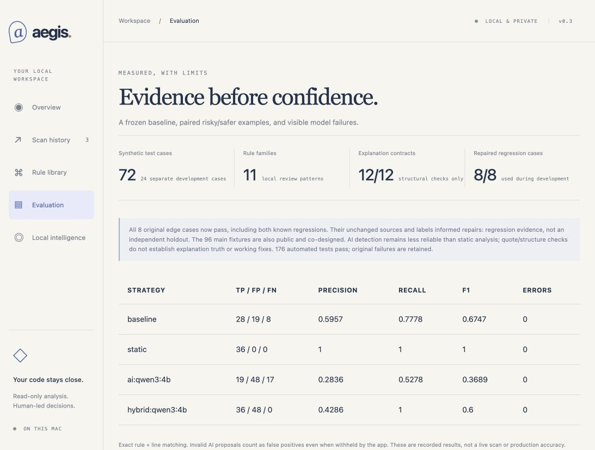

# Aegis - evaluated local AI code review

A read-only code-review prototype with 11 static rule families, optional local-model suggestions and source-validated structured explanations. Static analysis is the default because the recorded local AI detector is less reliable.



## v2: eight repaired cases, with the history retained

- Python lambda varargs/kwargs and comprehension targets get bounded scope handling, including the surrounding function. Defaults and outer iterable expressions remain visible to analysis.
- JavaScript, JSX, TypeScript and TSX now use pinned Tree-sitter syntax grammars instead of lexical masking. Executable template substitutions are traversed while inert text/comments/regex bodies are ignored.
- Optional global eval calls, default Node child_process imports and sequential alias reassignment are handled for the tested patterns; an unrelated object method named eval is not treated as the global builtin.
- All eight original edge cases pass, including the two previously observed regressions. Sources and expected labels are unchanged; tests compare them with the original failure record.
- **176 automated tests pass**, including related syntax/scope variants, API/AI contracts, redaction, migrations and exports. The CI workflow also gates all eight repaired cases.

These are development/regression cases used to build the repair, not an independent holdout. The previous failures remain in [the v1 report](evaluation/results/challenge.md); the [new repaired-case report](evaluation/results/v2/challenge.md) records 3 TP / 0 FP / 0 FN across 8 cases (3 positive, 5 negative). No broad language coverage, exploitability, production accuracy or independent generalization claim is justified.

## Run locally

Python 3.11+; verified locally on 3.14, with hosted checks on the PR. Run `sh start.sh`, then open http://127.0.0.1:8090. First run installs pinned requirements into .venv, including Tree-sitter and its JS/TS grammars. The startup dependency check also handles older installations missing the grammars. Set `PORT` for another port.

Optional Ollama defaults to http://127.0.0.1:11434; `AEGIS_OLLAMA_URL` accepts another HTTP loopback endpoint. Install a completion model separately. Aegis never downloads one automatically. Model requests have no tools and cannot execute/edit code.

Explore the intentionally unsafe sample, inspect each finding and source line, record a human decision, and export Markdown/JSON. Source is parsed/read, never executed or installed. Complete uploads are not persisted.

## Recorded evaluation

[Protocol and reproduction](evaluation/PROTOCOL.md) | [Final 72-case comparison](evaluation/results/v2/test-qwen3-4b.md) | [24 development cases](evaluation/results/v2/dev-static.md) | [Explanation contracts](evaluation/results/v2/explanations-qwen3-4b.md)

The original 96 synthetic fixtures are unchanged: 24 development and 72 test. The test split has 35 positive cases containing 36 expected leads, 36 negatives and one parse-abstention case. These public, co-designed fixtures are regression evidence, not independent security accuracy. AI and hybrid share a response per case.

| Strategy / 72 test cases | TP | FP | FN | Precision | Recall | F1 |
|---|---:|---:|---:|---:|---:|---:|
| baseline | 28 | 19 | 8 | 0.5957 | 0.7778 | 0.6747 |
| static | 36 | 0 | 0 | 1.0 | 1.0 | 1.0 |
| ai:qwen3:4b | 19 | 48 | 17 | 0.2836 | 0.5278 | 0.3689 |
| hybrid:qwen3:4b | 36 | 48 | 0 | 0.4286 | 1.0 | 0.6 |

Explanation contract rerun: **12/12 structural passes**. This does not measure independent semantic correctness. Exact quotes establish provenance, not the truth of the model's interpretation or the validity of a fix.

AI still adds many false positives; it did not improve detection in this experiment. Invalid proposals count as benchmark FPs even when the product withholds them. Provider errors/declines are retained rather than treated as successful clean reviews. Full JSON/JSONL evidence includes source/labels, raw outputs, diagnostics, model digests, dependency versions, settings, source hashes and timing. Original v1 results and the separately labeled initial v2 rerun are preserved.

## Architecture and boundaries

FastAPI -> bounded workers -> Python AST / JS and TS syntax trees / secret text checks -> optional loopback Ollama -> evidence validation -> SQLite -> human triage and export. Vanilla browser UI. Static + local AI is opt-in; the union never removes a static finding and falls back to saved static results when AI is busy/offline/invalid.

Static limits: 100 files, 150,000 characters each, 2 MB source, 4 MB HTTP body. AI mode: 8 files, 12,000 characters each, 48,000 total. Two workers, four queued/running jobs, one model request at a time.

**Single-user loopback only; no authentication and no public tunnels.** Host/Origin/write-header checks and CSP reduce accidental cross-origin access; local programs/users may still access the service. AI detection sends selected source after best-effort redaction to local Ollama; explanations send only a redacted finding. Private-key bodies are masked with line positions retained. Redaction is not guaranteed. Names, redacted excerpts, findings, AI text and notes persist in data/aegis.db; complete source uploads are not saved. Review exports before sharing.

A finding is a review lead, not a proven exploit. Parsing does not supply type resolution, a cross-file call graph, full control-flow/taint analysis, closure/hoisting/runtime semantics or input reachability. HTML coverage is limited to inline scripts; malformed scripts produce a coverage warning and only secret/key text checks. Python global/nonlocal/walrus/complex control flow and JS dynamic properties, complex aliasing and interprocedural flows remain limited. There is no dependency advisory database, runtime attack testing or verified automatic remediation. Clean scans do not prove security.

## Verify

```sh
python -m pytest -q
node --check static/app.js
python -m evaluation.run --split test --output /tmp/aegis-static
python -m evaluation.gate /tmp/aegis-static.json
python -m evaluation.probe --output /tmp/aegis-repaired
```

Implementation and fixtures were developed with AI assistance. Resume descriptions can cite the prototype, reproducible comparisons, evidence validation and verified regression coverage; avoid unsupported claims of independent authorship, real incidents prevented, production adoption, exploits or accuracy. Aegis runs independently of Orbit and Relay.
